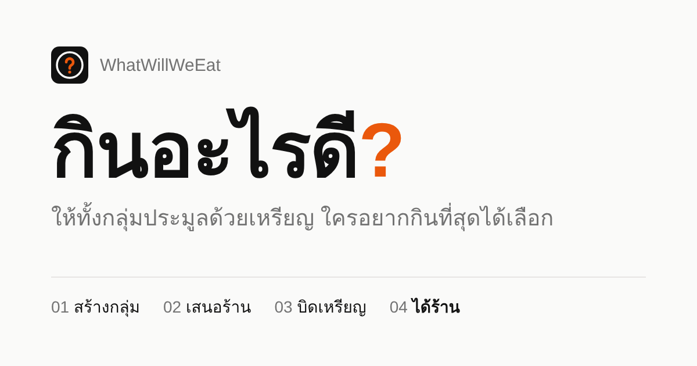
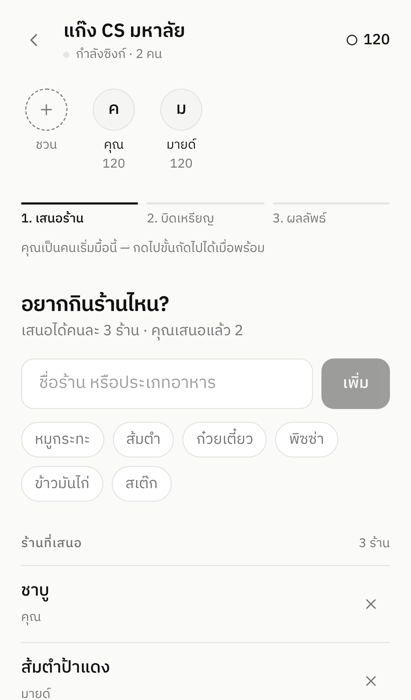
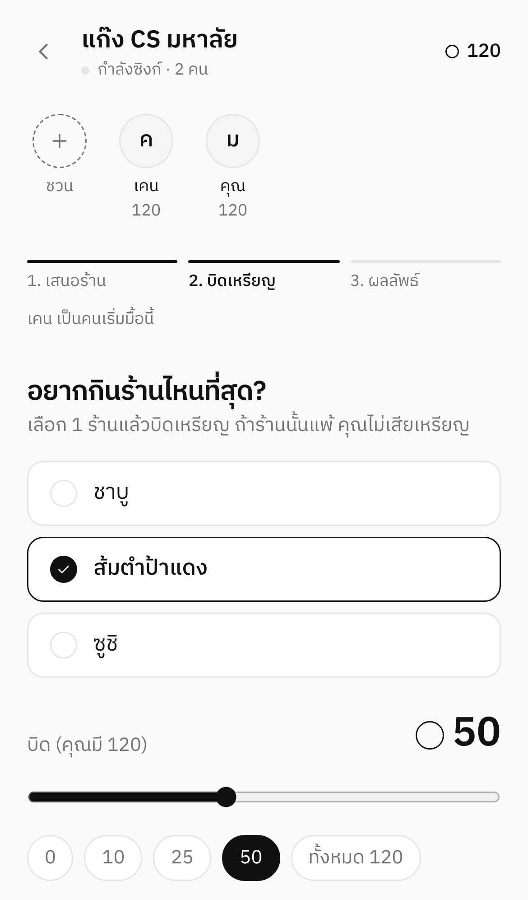
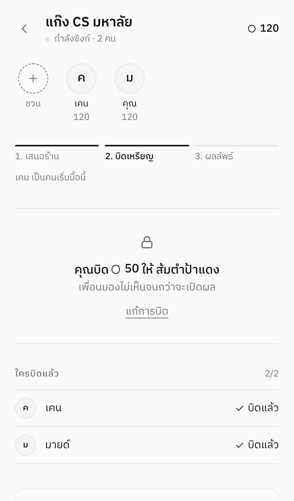
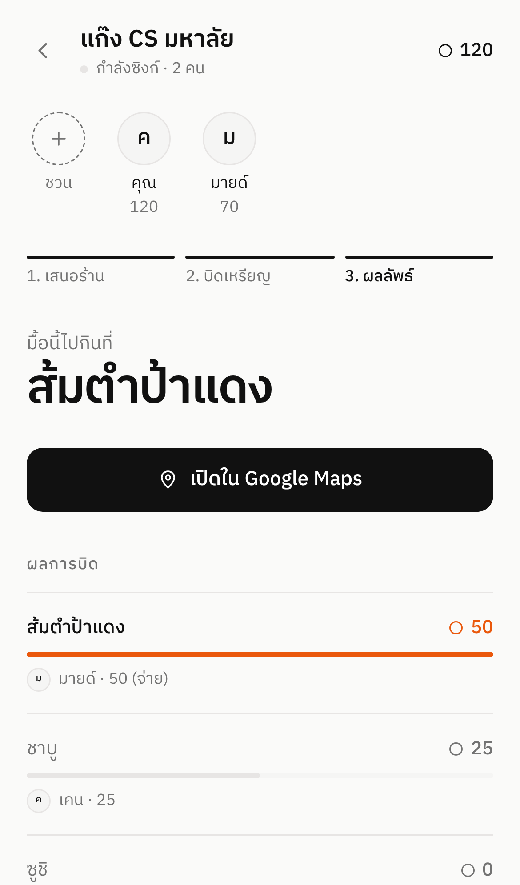
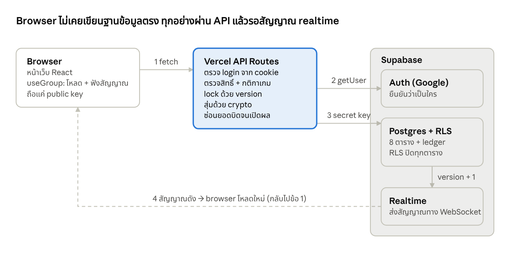

# WhatWillWeEat — กินอะไรดี?



> เลิกถาม "แล้วแต่" — ให้เพื่อนทั้งกลุ่ม **ประมูลด้วยเหรียญ** ใครอยากกินที่สุดได้เลือก

**Live:** https://whatwillweeat.vercel.app &nbsp;·&nbsp; **Stack:** Next.js 15 · TypeScript · Tailwind CSS · Supabase (Postgres + Auth + Realtime) · Vercel · Vitest · GitHub Actions

| 1. เสนอร้าน | 2. บิดแบบปิดซอง | 3. รอเปิดผล | 4. ผลลัพธ์ |
|---|---|---|---|
|  |  |  |  |

---

## ทำอะไรได้บ้าง

1. **เข้าสู่ระบบด้วย Google** แค่กดครั้งเดียว
2. **สร้างกลุ่ม** แล้วส่งลิงก์เชิญทาง LINE เพื่อนกดลิงก์เดียวก็เข้ากลุ่มได้ ไม่ต้องพิมพ์รหัส
3. **เริ่มมื้อใหม่** แล้วทุกคนเสนอร้านที่อยากกิน (คนละไม่เกิน 3 ร้าน และระบบกันร้านซ้ำให้) คนที่กดเริ่มมื้อจะเป็น **เจ้าของมื้อ** และเป็นคนเดียวที่พาไปขั้นถัดไปหรือยกเลิกมื้อได้ คนอื่นจะเห็นแถบ "รอ ..." แทน
4. **บิดเหรียญแบบปิดซอง**: ทุกคนบิดพร้อมกัน และไม่มีใครเห็นยอดของคนอื่นจนกว่าจะเปิดผล
5. **เปิดผล**: มีอนิเมชันลุ้นผล ร้านที่ได้เหรียญรวมมากที่สุดชนะ แล้วกดเปิด Google Maps ได้ทันที
6. ทุกหน้าจอ **อัปเดตแบบ real-time** ถ้าเพื่อนทำอะไร ทุกคนจะเห็นทันที
7. **มื้อไม่ค้าง**: ถ้าเจ้าของมื้อหายไปและมื้อไม่ขยับเกิน 10 นาที สมาชิกคนอื่นยกเลิกมื้อได้
8. **แชร์ลิงก์แล้วมีการ์ด preview** ใน LINE / Facebook ขึ้นชื่อกลุ่มกับจำนวนคน
9. **ตอบสนองทันที**: มี skeleton ระหว่างโหลดหน้า ร้านที่เพิ่งเพิ่มหรือการบิดจะแสดงขึ้นทันทีโดยไม่ต้องรอ server (optimistic UI) และเปลี่ยนขั้นตอนแบบลื่น

### กติกาเหรียญ

| เหตุการณ์ | เหรียญ |
|---|---|
| เข้ากลุ่มครั้งแรก | +100 |
| เริ่มมื้อใหม่ (ทุกคนในกลุ่ม) | +20 |
| ร้านที่บิดให้ **ชนะ** | จ่ายตามจำนวนที่บิด |
| ร้านที่บิดให้ **แพ้** | ไม่เสียเหรียญ |
| เก็บสะสมได้สูงสุด | 200 |

**ทำไมถึงยุติธรรม:** คนที่แพ้บ่อยจะไม่เสียเหรียญ จึงสะสมเหรียญไว้ได้มากกว่าคนอื่น และในรอบต่อไปก็มีโอกาสได้เลือกร้านเอง ส่วนเพดาน 200 เหรียญช่วยกันไม่ให้ใครเก็บเหรียญไว้จนชนะได้ทุกรอบ

---

## สถาปัตยกรรม



<details>
<summary>แบบข้อความ</summary>

```
 Browser (Next.js React)                Vercel (Next.js API Routes)            Supabase
 ┌──────────────────────┐   fetch     ┌───────────────────────────┐  secret  ┌──────────────┐
 │ หน้าเว็บ               │ ──────────▶ │ /api/groups/:id/action    │ ───────▶ │ Postgres     │
 │                      │             │  • ตรวจ login (cookie)    │   key    │  (RLS ปิดตาย) │
 │                      │ ◀────────── │  • ตรวจกติกา + สุ่มผล     │          │              │
 │                      │   JSON      │  • optimistic locking     │          │ group_signals│
 │                      │             └───────────────────────────┘          │  version ++  │
 │  ฟัง Realtime ───────┼──────────── WebSocket ───────────────────────────── │──────┘       │
 └──────────────────────┘     "version เปลี่ยน → ไปโหลดใหม่"                     └──────────────┘
```

</details>

### จุดที่ออกแบบไว้ (เอาไว้เล่าตอนสัมภาษณ์)

| เรื่อง | ทำอย่างไร | เพราะอะไร |
|---|---|---|
| **ความปลอดภัยของข้อมูล** | เปิด Row Level Security ทุกตาราง ให้ browser อ่านได้แค่ `group_signals` (มีแค่ตัวเลข version) ส่วนการอ่านและเขียนอื่นทั้งหมดต้องผ่าน API ซึ่งใช้ secret key ที่อยู่บน server เท่านั้น | ต่อให้มีคนเปิด DevTools ก็แก้เหรียญหรือแอบดูยอดบิดของคนอื่นไม่ได้ |
| **ประมูลแบบปิดซอง** | API ส่งยอดบิดของคนอื่นมาให้เฉพาะเมื่อมื้อนั้นจบแล้ว ก่อนหน้านั้นส่งไปแค่รายชื่อคนที่บิดแล้ว | ความลับเก็บไว้ที่ server ไม่ได้แค่ซ่อนไว้บนหน้าจอ |
| **กดพร้อมกัน** | ใช้ optimistic locking: `UPDATE ... SET version = v+1 WHERE version = v` ถ้ามีคนแก้ไปก่อน คำสั่งจะอัปเดตได้ 0 แถว ระบบจึงรอแป๊บแล้วลองใหม่อัตโนมัติ (สูงสุด 5 ครั้ง) | เพื่อน 5 คนกดเพิ่มร้านพร้อมกันได้ ข้อมูลไม่หาย |
| **หักเหรียญครั้งเดียว** | ตอนเปิดผลใช้คำสั่ง `UPDATE meals ... WHERE status = 'bidding'` ถ้ามีคนกดเปิดผลซ้ำ ครั้งที่สองจะไม่มีแถวให้อัปเดต จึงไม่หักเหรียญซ้ำ | ทำให้การเปิดผลกดซ้ำได้โดยผลไม่เปลี่ยน (idempotent) |
| **บิดชนกับเปิดผล** | เปิดผลจะปิดรับบิดก่อน แล้วค่อยอ่านบิดไปคำนวณ และมี trigger ใน database ที่ปฏิเสธการเขียน `bids` ถ้ามื้อไม่ได้อยู่ในสถานะ `bidding` (ล็อกแถวมื้อแบบ `FOR SHARE` ระหว่างเช็ก) | บิดที่บันทึกได้ถูกนับครบทุกบิด บิดที่มาช้าได้ 409 ไม่มีบิดหลุดแบบไม่ถูกนับ |
| **มื้อค้าง** | คำนวณเวลาที่มื้อขยับล่าสุดจากเวลาสร้างมื้อ ร้าน และบิด ถ้าเกิน 10 นาที server ยอมให้คนที่ไม่ใช่เจ้าของยกเลิกได้ | เจ้าของมื้อปิดแอปไปแล้ว กลุ่มก็ยังไปต่อได้ |
| **สมุดบัญชีเหรียญ** | ไม่เก็บยอดเหรียญคงเหลือ แต่บันทึกทุกการเปลี่ยนแปลงลง `coin_ledger` แล้วคำนวณยอดจากผลรวม | ตรวจย้อนหลังได้ว่าเหรียญเพิ่มหรือลดเพราะอะไร ใช้หลักเดียวกับระบบบัญชีธนาคาร |
| **สุ่มที่ server** | กรณีเสมอใช้ `crypto.randomInt` บน server | ทุกจอเห็นผลเดียวกัน และโกงผลจาก browser ไม่ได้ |
| **Real-time** | ทุกจอฟังการเปลี่ยนแปลงของ `group_signals` ผ่าน Supabase Realtime เมื่อได้สัญญาณก็โหลดข้อมูลใหม่ ถ้า realtime ใช้ไม่ได้จะสลับไปดึงข้อมูลเองทุก 3 วินาที (polling) | ถ้าเน็ตแย่หรือ realtime ล่ม ระบบยังทำงานต่อได้ |
| **หนึ่งกลุ่ม มีมื้อเปิดได้ทีละมื้อ** | ใช้ partial unique index: `unique (group_id) where status in ('adding','bidding')` | ฐานข้อมูลบังคับกฎนี้เอง โค้ดจึงเปิดมื้อซ้อนไม่ได้ ต่อให้มีบั๊ก |
| **กันร้านซ้ำ** | แปลงชื่อร้านเป็นรูปแบบเดียวกันก่อนเทียบ (normalize) เช่น `" Mo  MO "` กลายเป็น `"mo mo"` และมี `unique (meal_id, name_key)` | กันไม่ให้มีร้านเดียวกันซ้ำในมื้อเดียว |
| **สิทธิ์เจ้าของมื้อ** | server ตรวจว่า `meals.created_by` ตรงกับคนที่กด ก่อนยอมให้ไปขั้นถัดไป เปิดผล หรือยกเลิก ถ้าไม่ตรงจะตอบ 403 ส่วนหน้าเว็บก็ซ่อนปุ่มเหล่านี้ไว้ด้วย | ซ่อนปุ่มอย่างเดียวไม่พอ เพราะยังยิง API ตรงได้ |
| **Tests + CI** | unit test กติกาเกมใน `src/lib/logic.ts` (Vitest) + integration test ยิง API จริงบน Postgres (`tests/api.test.mjs`) รันอัตโนมัติทุก push ด้วย GitHub Actions | พิสูจน์ได้ว่ากดพร้อมกัน, บิดลับ, เปิดผลซ้ำ, สิทธิ์ 403 ทำงานจริง ไม่ใช่แค่ในทฤษฎี |

### โครงสร้างไฟล์

```
supabase/schema.sql          ← ตารางทั้งหมด + RLS + trigger + realtime (รันครั้งเดียว)
supabase/migrations/         ← SQL สำหรับอัปเดต database ที่ deploy ไปแล้ว
src/lib/logic.ts             ← กติกาเกม (pure functions) + logic.test.ts
src/lib/group-service.ts     ← business logic ฝั่ง server ทั้งหมด
src/lib/auth.ts              ← Google login ผ่าน Supabase Auth
src/app/api/...              ← REST API (route handlers)
src/hooks/useGroup.ts        ← โหลดข้อมูล + realtime + polling
src/app/g/[id]/page.tsx      ← หน้ากลุ่ม (หน้าหลักของเกม)
src/components/              ← AddRestaurants, Auction, Result, ...
tests/api.test.mjs           ← integration tests (ยิง API จริง)
scripts/test-stack.sh        ← ตั้ง Postgres + PostgREST + แอป สำหรับเทส (ใช้ใน CI)
.github/workflows/ci.yml     ← lint, typecheck, unit + integration tests
```

---

## วิธี Deploy (ประมาณ 30 นาที)

### 1. Supabase
1. ไปที่ [supabase.com](https://supabase.com) แล้วกด **New project** (เลือก Region เป็น Singapore)
2. เปิด **SQL Editor** วางไฟล์ `supabase/schema.sql` ทั้งไฟล์ แล้วกด **Run**
3. เปิด **Project Settings → API Keys** แล้วจดค่าเหล่านี้ไว้
   - Project URL
   - Publishable key (หรือ `anon` key)
   - Secret key (หรือ `service_role` key) **ห้ามเปิดเผย**

### 2. Google Login
1. ไปที่ [console.cloud.google.com](https://console.cloud.google.com) แล้วสร้างโปรเจกต์ใหม่
2. เข้า **APIs & Services → OAuth consent screen** เลือก External แล้วกรอกชื่อแอปกับอีเมล จากนั้นกด **Publish app**
3. เข้า **Credentials → Create credentials → OAuth client ID** เลือกประเภท **Web application**
   - **Authorized redirect URIs:** `https://<project-ref>.supabase.co/auth/v1/callback`
     (คัดลอกได้จากหน้า Supabase → Authentication → Providers → Google)
4. คัดลอก Client ID และ Client Secret ไปใส่ใน **Supabase → Authentication → Providers → Google** แล้วเปิดใช้งาน

### 3. Vercel
1. Push โค้ดขึ้น GitHub
2. ไปที่ [vercel.com](https://vercel.com) กด **Add New → Project** แล้ว import repo
3. ใส่ **Environment Variables** 3 ตัวนี้ (ดูตัวอย่างใน `.env.example`)
   ```
   NEXT_PUBLIC_SUPABASE_URL
   NEXT_PUBLIC_SUPABASE_ANON_KEY
   SUPABASE_SERVICE_ROLE_KEY
   ```
4. กด **Deploy** จะได้ URL เช่น `https://whatwillweeat.vercel.app`

### อัปเดต database ที่ deploy ไปแล้ว
ถ้าเคยรัน `schema.sql` เวอร์ชันเก่าไปแล้ว ให้รันไฟล์ใน `supabase/migrations/` ที่ยังไม่เคยรันใน SQL Editor (รันซ้ำได้ ไม่พัง)

### 4. กลับไปตั้งค่าที่ Supabase
เปิด **Authentication → URL Configuration**
- **Site URL:** `https://whatwillweeat.vercel.app`
- **Redirect URLs:** เพิ่ม `https://whatwillweeat.vercel.app/**` และ `http://localhost:3000/**`

เสร็จแล้ว ลองเปิด URL บนมือถือ login แล้วสร้างกลุ่มดูได้เลย

---

## รันในเครื่อง

```bash
npm install
cp .env.example .env.local    # แล้วใส่ค่าจาก Supabase
npm run dev                   # http://localhost:3000
npm test                      # unit tests
```

**Integration tests** ต้องมี Postgres (เช่น `docker run -p 5432:5432 -e POSTGRES_PASSWORD=postgres postgres:16`) แล้วรัน
```bash
PGHOST=localhost PGUSER=postgres PGPASSWORD=postgres ./scripts/test-stack.sh
set -a && . ./.env.test && set +a && npm run test:api
```
ใน GitHub Actions ทำขั้นตอนนี้ให้อัตโนมัติทุกครั้งที่ push

ถ้าอยากทดสอบหลายคนโดยไม่ต้องใช้บัญชี Google ให้ใส่ `DEV_FAKE_AUTH=1` และ `NEXT_PUBLIC_DEV_FAKE_AUTH=1` ใน `.env.local` จะ login ด้วยชื่ออะไรก็ได้ (โหมดนี้ปิดเองอัตโนมัติบน production)

---

## แผนต่อไป
- ออกจากกลุ่ม / เจ้าของกลุ่มนำสมาชิกออก
- ย้ายการเปิดผลไปเป็น Postgres function ให้ทุกขั้นอยู่ใน transaction เดียว
- Rate limit ต่อผู้ใช้ และ load test
- แจ้งเตือนผ่าน LINE เมื่อเพื่อนเริ่มมื้อใหม่
- ปักหมุดร้านโปรดของกลุ่ม แล้วกดเลือกใส่ได้เร็ว ๆ
- สถิติกลุ่ม เช่น ร้านที่ชนะบ่อยที่สุด หรือใครเป็นนักบิดตัวยง
